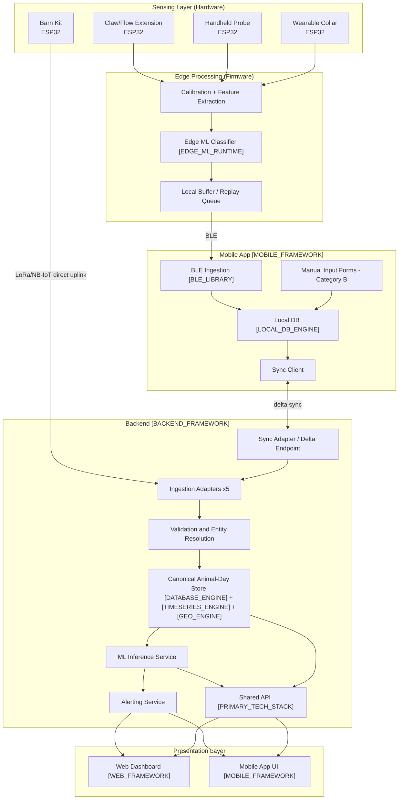

# PashuParth — High-Level Design (HLD)

**Project:** PashuParth (SIH2026, PS 26109)
**Core Functionality:** AI/IoT-based early forecasting of bovine mastitis in Indian dairy farms — 7–14 day pre-clinical risk prediction at animal and herd level.
**Document Scope:** System architecture, tech stack, data flow, API strategy, and database schema strategy across Web and Mobile App, sharing one backend.

> **Note on placeholders:** Hardware components reflect PashuParth's locked architecture. Software framework/library choices are intentionally left as `[PLACEHOLDER]` tokens so this HLD can be finalized against final stack decisions without altering system structure.

---

## 1. System Architecture Overview

PashuParth is a layered, offline-tolerant system spanning field hardware, a mobile ingestion app, a synchronized backend, an ML inference layer, and dual client surfaces (Web dashboard + Mobile app) sharing one API contract.

**Layers:**

1. **Sensing Layer (Hardware)** — physical data acquisition at the animal/farm level.
2. **Edge Processing Layer (Firmware)** — on-device calibration, feature extraction, local buffering.
3. **Mobile Ingestion Layer** — BLE/LoRa reception, local-first persistence.
4. **Sync Layer** — reconciles local and remote state under intermittent connectivity.
5. **Backend / API Layer** — shared contract for Web and Mobile.
6. **Data Layer** — canonical animal-day store (time-series + relational + geo).
7. **ML/Inference Layer** — risk scoring and forecasting.
8. **Presentation Layer** — Web dashboard (Admin/Vet/Cooperative) + Mobile app (Farmer/Vet/Field Personnel).

---

## 2. Tech Stack

### 2.1 Hardware (locked, actual)

| Module | Components | MCU | Comms |
|---|---|---|---|
| Claw/flow extension | Flow sensors (per teat), optical clot sensor, per-quarter EC probe | ESP32 | BLE |
| Handheld probe | EC (555-timer astable excitation, SS304 electrodes), pH probe, milk/udder temperature, RFID reader | ESP32 | BLE |
| Wearable collar | MPU6050 (rumination/feeding/activity classification), body temp sensor, GPS module | ESP32 | BLE |
| Barn kit | Temperature, humidity, ammonia (NH₃), CO, CO₂, bedding moisture sensors | ESP32 | LoRa / NB-IoT |

### 2.2 Software (generic, placeholder — to be finalized)

| Layer | Placeholder |
|---|---|
| Web frontend framework | `[WEB_FRAMEWORK]` |
| Mobile app framework | `[MOBILE_FRAMEWORK]` |
| BLE communication library (mobile) | `[BLE_LIBRARY]` |
| Local-first embedded database (mobile) | `[LOCAL_DB_ENGINE]` |
| Backend runtime/framework | `[BACKEND_FRAMEWORK]` |
| Primary database engine | `[DATABASE_ENGINE]` |
| Time-series storage extension/engine | `[TIMESERIES_ENGINE]` |
| Geospatial storage extension/engine | `[GEO_ENGINE]` |
| Auth/identity provider | `[AUTH_PROVIDER]` |
| ML serving/inference runtime | `[ML_SERVING_RUNTIME]` |
| Edge inference runtime (on-MCU) | `[EDGE_ML_RUNTIME]` |
| Push/SMS notification provider | `[NOTIFICATION_PROVIDER]` |
| Overall primary stack designation | `[PRIMARY_TECH_STACK]` |

---

## 3. Data Flow

---

## 4. API Strategy

**Principle:** One backend, one API contract, consumed identically by Web and Mobile.

- **Contract identity:** All CRUD and query endpoints (animal records, risk assessments, alerts, herd dashboards) are defined once and versioned centrally (`/api/v[N]/...`). Web and Mobile never diverge on request/response shape.
- **Two access patterns, one contract:**
  - **Direct request/response** — used by Web (always-connected) via `[BACKEND_FRAMEWORK]` REST/GraphQL endpoints.
  - **Delta sync** — used by Mobile via a dedicated sync endpoint (`pullChanges` / `pushChanges` semantics) operating over the *same* underlying entities, not a parallel schema.
- **Auth:** Single identity/auth layer (`[AUTH_PROVIDER]`) issuing role-scoped tokens (Farmer / Vet / Field Personnel / Admin-Authority) consumed by both clients.
- **Realtime:** Alert delivery uses a push channel (`[NOTIFICATION_PROVIDER]`) independent of the sync protocol, to avoid the two mechanisms competing over the same write path.
- **Versioning discipline:** Breaking schema changes require a new API version; the mobile sync adapter and web REST layer must be migrated together to preserve contract identity.

---

## 5. Database Schema Strategy

**Principle:** Single canonical schema, single physical database, multiple access patterns — not a multi-database split.

- **Core store:** `[DATABASE_ENGINE]` as the system of record, extended with:
  - `[TIMESERIES_ENGINE]` for high-frequency sensor readings (hypertable-style partitioning on animal_id + timestamp)
  - `[GEO_ENGINE]` for farm/herd geo-hotspot queries (GIS layer)
- **Canonical entity model** (detailed in LLD Part 1):
  - Animal, Sensor Reading (per module), Manual Input Record, Risk Assessment, Alert, User/Role, Farm/Herd.
- **Change tracking:** Every table includes a `last_modified` timestamp and participates in a changelog/audit mechanism from day one — required for the Mobile delta-sync path and avoids retrofit cost later.
- **ID strategy:** Client-generated UUIDs (not server-generated serials) for any entity that can originate offline on Mobile (sensor readings, manual inputs), so records have stable identity before first sync.
- **Row-level access control:** Enforced at the database layer (role-scoped policies: Farmer sees own herd, Vet sees assigned farms, Admin/Authority sees aggregated/anonymized cross-farm data), applied consistently to both the direct API path and the sync path.
